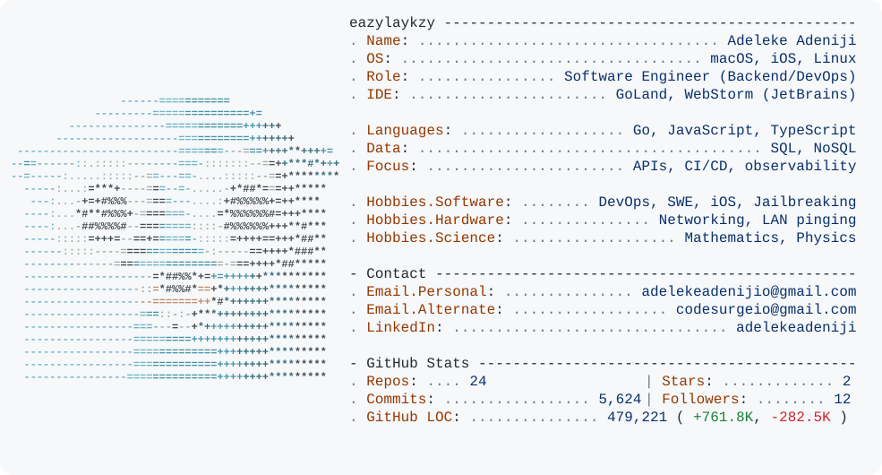

<picture>
  <source media="(prefers-color-scheme: dark)" srcset="./dark_mode.svg">
  <source media="(prefers-color-scheme: light)" srcset="./light_mode.svg">
  
</picture>

[Personal email](mailto:adelekeadenijio@gmail.com) · [Alternate email](mailto:codesurgeio@gmail.com) · [LinkedIn](https://www.linkedin.com/in/adelekeadeniji/)
